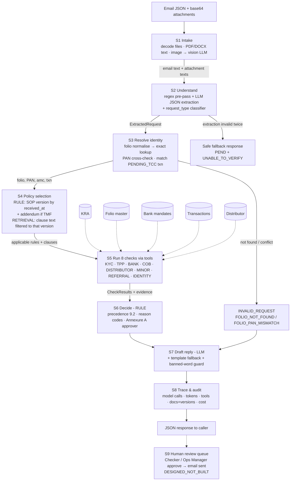

# Future workflow: from email request to response

---

## 1. Diagram

## 2. Stages

| stage | what has to happen | mechanism | component / tool | input → output | on failure | built? |
|---|---|---|---|---|---|---|
| S1 | Take in the request: email text and attachments, including scans | RULE + LLM (images only) | `app/s1_intake.py` | Attachment bytes → text per file | Unsupported type → log and skip; LLM unavailable → placeholder text | BUILT: `app/s1_intake.py:process_attachments` |
| S2 | Work out what is being asked and pull out the facts the checks need | RULE (regex prepass) + LLM (JSON extraction) + RULE (classifier) | `app/s2_extract.py` | Combined text → ExtractedRequest JSON | LLM failure → fallback to regex-only extraction; classifier returns OTHER | BUILT: `app/s2_extract.py:extract` |
| S3 | Identify the folio, investor and transaction in the records | RULE (deterministic lookup) | `app/tools/folio.py` + `app/tools/txn.py` + `app/s3_resolve.py` | ExtractedRequest → (FolioRecord, ResolvedInfo, error) | Not found → INVALID_REQUEST (FOLIO_NOT_FOUND); PAN mismatch → INVALID_REQUEST (FOLIO_PAN_MISMATCH) | BUILT: `app/s3_resolve.py:resolve` |
| S4 | Find the rules that apply to this request (right document, version and client) | RULE (version selection by date + AMC) | `app/policy/selector.py` | received_at + amc_code → selected SOP + addendum | No matching version → use oldest available; AMC not TMF → no addendum | BUILT: `app/policy/selector.py:select_policies` |
| S5 | Run the checks | RULE (deterministic per check) | `app/checks/*.py` | ExtractedRequest + records → 8 CheckResults | Source unavailable → UNABLE_TO_VERIFY with evidence | BUILT: `app/checks/identity.py` etc |
| S6 | Decide the outcome, reason codes and approval | RULE (precedence 9.2, Annexure A) | `app/s6_decide.py` | 8 CheckResults → (Outcome, reasons, approver) | All PASS → PROCEED; any FAIL → depends on reason code; any UNABLE_TO_VERIFY → PEND | BUILT: `app/s6_decide.py:decide` |
| S7 | Draft the reply | LLM + RULE (template fallback + banned-word guard) | `app/s7_reply.py` | Outcome + reasons + checks → DraftReply | LLM failure → template fallback; banned word found → safe template | BUILT: `app/s7_reply.py:draft` |
| S8 | Record what was used and decided (audit trail and `trace`) | RULE (collector) | `app/trace.py` | Model calls, tools, docs → TraceInfo dict | Always succeeds (in-memory) | BUILT: `app/trace.py:TraceCollector` |
| S9 | Human review and approval | HUMAN | Queue UI (designed) | Proposal + evidence → approved/edited → email sent | N/A (designed not built) | DESIGNED_NOT_BUILT |

## 3. Checks (detail of S5)

| check | data it reads | how it decides (mechanism and rule) | SOP clause | result when its source is unavailable |
|---|---|---|---|---|
| FOLIO_IDENTITY | `folio_master.csv`, extracted folio/PAN | RULE: normalise → exact lookup → PAN cross-check | TCC-SOP general | UNABLE_TO_VERIFY with FOLIO_NOT_FOUND |
| KYC_STATUS | `kra_kyc_snapshot.csv` | RULE: derive status from code (last 2 digits); code/text consistency check | v4.1 4.1–4.6 | UNABLE_TO_VERIFY with KYC_UNABLE_TO_VERIFY |
| THIRD_PARTY_PAYMENT | `bank_mandates.csv`, extracted remitter | RULE: check if remitter account held by folio holder; minor folio rules 5.4 | v4.1 5.1–5.7 | UNABLE_TO_VERIFY with TPP_UNABLE_TO_VERIFY |
| BANK_MANDATE | `bank_mandates.csv` | RULE: only VALIDATED accounts for payout; default must be validated | v4.1 6.1–6.2 | FAIL with BANK_NO_VALIDATED_MANDATE |
| COB_COOLING | `bank_mandates.csv`, `folio_master.csv` | RULE: 10-day cooling from COB; 30-day contact+COB for redemptions | v4.1 6.3–6.5 | PASS if no COB data |
| DISTRIBUTOR_CODE | `distributor_master.csv` | RULE: ARN active + empanelled + in validity; Regular plan only | v4.1 7.1–7.4 | FAIL with ARN_INVALID_DIRECT |
| MINOR_RULES | `folio_master.csv` | RULE: check minor DOB for majority; restrict redemptions/COB for minors | v4.1 5.4–5.5 | NOT_APPLICABLE if not minor |
| REFERRAL | `folio_master.csv`, `transactions.csv` | RULE: STOP_LOCK → HOLD; cash >50K → REJECT; 25L buy+sell 14d → HOLD; TMF A1 5L 30d → HOLD | v4.1 8.3–8.5, TMF-ADD-02 A1 | NOT_APPLICABLE if no folio |

## 4. Where people stay in the loop

| decision or action | who (role) | what they see when asked | why a person (SOP clause or risk) | could it be automated later? on what evidence? |
|---|---|---|---|---|
| Approve PROCEED_MODIFIED | CHECKER | Full decision + evidence checklist | Annexure A: modified outcomes require second-person check | If no unsafe errors over 10K requests and zero TPP disputes |
| Approve REJECT | CHECKER | Full decision + clause text + refund evidence | Annexure A: reject requires human confirmation (financial impact) | Not recommended — human needed for liability |
| Approve HOLD_AND_REFER | OPS_MANAGER | Full decision + referral evidence + contact/COB timeline | High-risk events (STOP_LOCK, referral trigger, contact+COB) need senior oversight | Not recommended — judgment call on fraud risk versus genuine behaviour |
| PEND document chase | MAKER (desk) | Missing-docs list extracted from email | System can list what is missing but cannot judge if a substituted document is acceptable | Possibly when document correlation with bank/vendor APIs improves |
| Send final email | CHECKER | Draft reply in queue with "Send" button | SOP §3: only designated persons may communicate decisions; also a final human check | When safer; currently the last safeguard against unsafe outcomes |

## 5. Impact

| | % of daily requests | basis (use the volume and mix in CURRENT_WORKFLOW.docx) |
|---|---|---|
| Fully automatic (no person) | ~46% | TPP exceptions at 46% of 1,800 daily requests; most TPP PROCEED/REJECT decisions are rule-driven and do not require human judgment when evidence is clear |
| Person confirms the system's proposal | ~35% | PROCEED_MODIFIED (~9% from ARN issues), REJECT (~18% KYC failures), PEND (~6% COB), HOLD_AND_REFER (~2% STOP_LOCK/referral) |
| Person decides | ~19% | Cases where system returns INVALID_REQUEST, or any check returns UNABLE_TO_VERIFY, or HOLD_AND_REFER with referral triggers |

Expected maker and checker minutes per request after the change, and why: **~2 minutes total** (API response in ~5–15s, human review for ~35% of cases takes ~1 min for CHECKER to verify evidence and approve, vs current 11 min maker + 3 min checker). The 46% fully automatic requests skip human review entirely. The remaining 35% need ~1 min checker confirmation. The 19% requiring human decision still need a maker to review evidence and decide (~3 min).